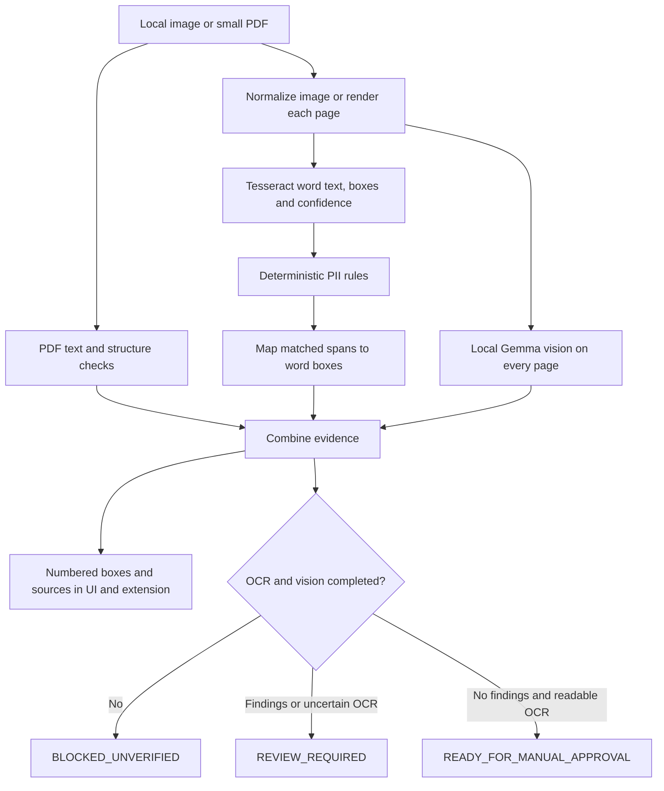

# Iteration 3: OCR, rules and Gemma detection evidence

Status: implemented and tested with synthetic doubles on Windows. Native OCR and combined live Gemma quality on the target Mac remain UNVERIFIED for this iteration.

## Accepted scope

Improve upload detection before expanding export or interception. The previous Mac image smoke returned PERSON but missed the synthetic email. A successful model request is not a recall test.



## Logic

- `privacygate/ocr.py` invokes local Tesseract with PNG stdin and TSV stdout, without a shell or application-created temporary image/transcript files. Timeout: 30 seconds/page. It validates word geometry, finite 0..100 confidence, a 2-million-character TSV limit and 10,000-word limit. TSV size is checked after process capture; native subprocess memory is not OS-limited yet.
- OCR text stays internal. Rules use exact offsets; matched words produce normalized `[top,left,bottom,right]` boxes. Multi-line matches produce separate line boxes. Names, addresses and photographs still rely on semantic vision and manual inspection.
- Rule score and OCR confidence have separate meanings and fields. Any word below 70/100 or a page without recognized words forces review, even with no findings. This threshold is uncalibrated; blank pages can cause unnecessary review. High OCR confidence never skips Gemma or establishes absence of PII.
- Every normalized page receives Gemma vision regardless of OCR quality. Confidence-based routing is deferred until benchmarks justify it.
- Same-page, same-entity boxes with intersection-over-union >= 0.5 share an `evidence_sources` list. Retain the first box (OCR precedes vision) and its score; never invent an averaged probability. Conflicting labels, different regions and unlocated findings stay separate. Duplicates remain possible.
- OCR failure on any page blocks the whole upload, keeps earlier findings and still attempts vision. Vision failure also blocks. Uploads always require human review and never enable file transfer or redacted export.
- Preview responses/downloads contain original visible pixels. OCR transcripts are not returned. Existing PDF text-layer sanitized output only masks rule matches and can retain missed PII.

## Mac setup

From the activated project virtual environment, with LM Studio and the previously validated Gemma model running:

```sh
git pull --ff-only
python -m pip install -e .
brew install tesseract
tesseract --list-langs
python -m privacygate.macos_check --uploads --smoke --timeout 75
python scripts/benchmark_uploads.py --require-perfect
python scripts/benchmark_uploads.py --live-gemma
python scripts/smoke_local_uploads.py
python -m privacygate.web
```

The `--uploads` preflight checks executable/language availability using a blank image; quality is evaluated separately by the benchmark. Extension Settings still supplies the exact bridge command with extension origin/token. Reload the unpacked extension after pulling.

Default OCR language is English. Set `PRIVACYGATE_OCR_LANGUAGES=eng+hin+mar` only after installing those language data and confirming `tesseract --list-langs`; missing data blocks rather than silently dropping languages. `PRIVACYGATE_TESSERACT` accepts an absolute executable path, useful on Windows. Scans never download engines/data. Environment files still need explicit sourcing/exporting.

## Benchmarks

`scripts/benchmark_uploads.py` generates ten in-memory synthetic images: clean email, PAN, phone, checksum-valid synthetic Aadhaar, benign scheduling text, blank page, and four blurred identifier variants. It reports per-case/aggregate TP, FP, FN, precision/recall, localization matches at IoU >= 0.5, and median/max elapsed time. Detection matching requires correct entity and IoU >= 0.1; these are location-aware metrics. Correct but unlocated labels do not count as localized detections.

Default evaluates real OCR + rules. `--live-gemma` compares vision and combined predictions via loopback and can take minutes. Output contains aggregate metrics and synthetic case names, no transcripts/completions/images. Missing/failed engines exit 2 without a quality claim. Normal completion exits 0 even with misses; `--require-perfect` exits 1 for clean-subset OCR false positives/misses. Blurred cases measure degradation without requiring perfect recall. Mac CI installs native Tesseract and runs this clean-subset gate; inspect the actual CI result after push.

This tiny corpus is a regression baseline, not representative accuracy. Multi-page PDF integration, partial failures, offset mapping, response privacy, confidence behavior and evidence merging are unit-tested. Live scanned-PDF quality, skew/orientation, handwriting, multilingual documents, five-page latency and 8 GB memory remain pending. Only synthetic data belongs in tests/reports.

## Handoff

1. Run the commands above on the target Mac; record aggregate metrics and latency in PROGRESS.md.
2. Visually compare numbered boxes against synthetic images and scanned PDFs, including poor-quality pages.
3. Test the reloaded extension in the normal authenticated ChatGPT browser. Automated browser tests use a synthetic page and OCR/model doubles.
4. Expand a held-out corpus before tuning thresholds/routing. Secure file redaction and automatic attachment interception remain outside this iteration.
