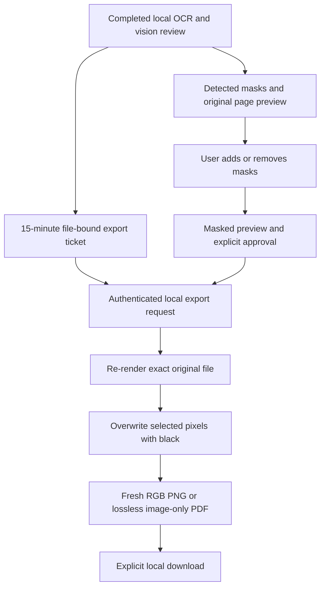

# Reviewed redaction and export

Extension v0.4.0 and the local UI now support editable masks and explicit file export. Existing 6 MB / 5-page / 2200-pixel render limits remain. No new Python dependency or extension permission was introduced.

## Use

1. Pull the update, reinstall the editable package if needed, restart the local bridge and reload the unpacked extension. Keep local Tesseract/language data and Gemma available as described in ITERATION_3.md.
2. Choose an image or small PDF and run file review. Missing/failed required OCR or vision blocks export.
3. Inspect every page. Detected located findings become default masks. Drag on a page to add a mask, or use Mask whole page for a conservative fallback; Remove deletes a mask so you can redraw it. Draw additional masks for missed/unlocated information. The list contains mask numbers, which can differ from original finding numbers after edits.
4. Select Show masked preview. Inspect the black masks, then check the separate export-review checkbox. Changing masks or preview mode revokes approval and removes any prepared download.
5. Prepare redacted PNG (single page) or PDF (one or more pages), then click the download link. Inspect the downloaded copy before manually attaching/sharing it.

The original annotated PNG download remains explicitly NOT redacted and contains identifying pixels. Redacted exports have a separate download link. Nothing is automatically attached or sent to ChatGPT.

## Architecture

`privacygate/redaction.py` reuses the same normalized image/PDF rendering path as review. Normalized integer boxes map to pixels with outward rounding and two extra pixels of padding; the editor shows the same mask bounds. A fresh RGB buffer holds masked pixels. PNG ancillary metadata is omitted. PDF export creates new PDF pages and Flate-compressed RGB image streams; it copies no original page objects, fonts, text layers, annotations, attachments, metadata or form fields. Source PDF page dimensions are retained as rendered (including rotation/crop); image-to-PDF uses pixel dimensions as PDF points. Exported PDFs are rasterized, lose searchability/accessibility/vector quality, and are limited to review render resolution. Digital signatures and interactive features are not retained. The original file is never overwritten.

`/v1/redact-export` retains exact-origin, bearer authentication, no-store, request-size and concurrency limits. A completed non-blocked file scan issues an HMAC-SHA256 ticket over expiry, source media type and SHA256 of original bytes. Tickets last 15 minutes and become invalid on bridge restart. Export requires the same source bytes, valid ticket, strict region bounds (maximum 500), supported output type and JSON boolean reviewed=true. A ticket proves only that configured detectors completed for those bytes; it is not proof of detection accuracy. This is a local human-controlled tool, not an attestation that a checkbox was meaningfully reviewed.

No source or generated file is cached on disk by the bridge. The browser retains private preview/source bytes in memory for the active result. Input/mode/config changes, tab disconnects, new scans and Clear invalidate previews and prepared download URLs; mask edits invalidate prepared exports. Export fetches have a 60-second timeout and are aborted on invalidation. Downloaded files remain on disk until the user deletes them. Logs omit request bodies and raw content.

## Extension improvements

- Separate file-review display from text approval/copy/insert controls; a file result cannot authorize text insertion.
- Add Cancel review and reject stale responses. Cancel aborts browser waiting; an already-running bridge/model task can continue until its own timeout and occupy a scanner slot.
- Allow up to 14 minutes for five pages of sequential 120-second Gemma and 30-second OCR work, with overhead; this does not claim measured latency.
- Reuse one shared preview/editor for web and extension; no external script/runtime or download permission.

## Validation and limitations

Python tests check exact masked pixels, padding, unchanged unmasked pixels, lossless PDF raster contents, text/metadata/attachment exclusion, preserved page count/dimensions, invalid geometry, strict approval, auth, file binding, missing/tampered/expired tickets, and blocked-scan behavior. Chromium integration runs the installed extension against the real bridge with synthetic OCR/model doubles: draw/remove masks, approval reset, binary PNG pixel verification, PNG/PDF downloads and stale-link invalidation. A two-page exported PDF is reopened and rendered for visual inspection.

These checks establish removal of pixels inside selected masks and exclusion of source PDF structures. They do not establish that all personal information was detected or masked. Mask padding is a small boundary allowance, not a guarantee about an imprecise detector box. Native parser/process memory isolation, independent security audit, target-Mac OCR/Gemma quality, 8 GB memory/latency and the normal authenticated ChatGPT browser remain pending. Only synthetic documents are used in repository tests.
