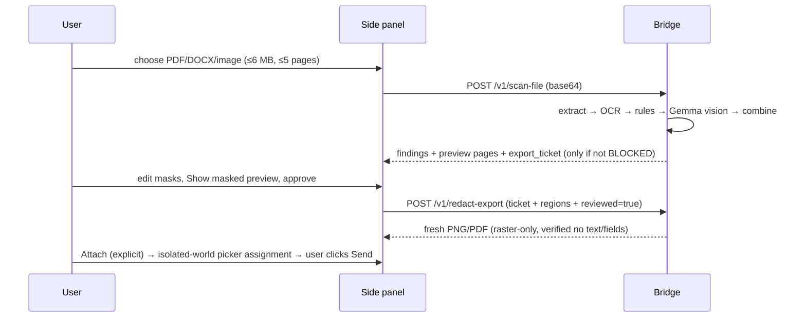
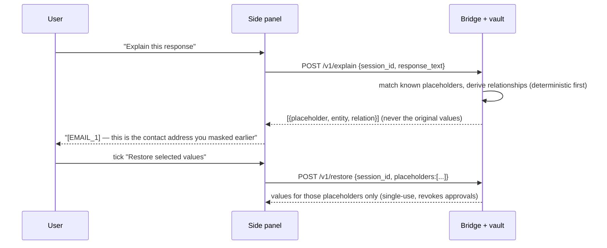

# Parda — Living Extension Architecture & Implementation Roadmap

**Artifact type:** living plan (audit, architecture, prioritized roadmap, evidence log).
**Created:** 2026-10-25 · **Audit basis:** commit `79ddbe60cf24ea1db9a306e05d97a49d1cc3765a` ("Record successful extension attachment integration CI", 2026-10-25T01:35:41+05:30), branch `main`, working tree clean at time of writing.
**Scope of this document:** planning only. No application source code was modified to produce it.

> **Naming note (assumption, needs owner confirmation):** this repository, its package, docs and extension are branded **PrivacyGate**; the string `parda` appears in **zero** repository files. This plan uses "Parda" as the intended product name and "PrivacyGate" as the current code/brand identity. Renaming is a documentation-only task and is not on any critical path.

---

## 1. How to use this plan (maintenance procedure)

Re-run this document whenever the prompt that created it is used again after repository changes.

1. `git log --oneline -10 && git status --short` — record the new HEAD and any dirty files.
2. `git diff --stat <last-audited-commit>..HEAD` — list changed modules. If a module was already verified and is untouched, do **not** re-audit it; state that it is unchanged since the recorded commit.
3. Re-inspect deeply only changed/impacted modules, plus the modules they call.
4. Re-run the verification block in §2 and record real numbers. Never carry forward a passing result as if it were re-measured.
5. Compare implementation against §4 (gap matrix) and §6 (roadmap). Move tasks between Completed / Pending / Blocked / Unverified **only** with code or test evidence.
6. Append to §8 (decision log) for any new decision; strike obsolete assumptions in §9 rather than deleting them silently.
7. Reorder §6 if blockers, dependencies or risks changed.
8. Record the new audited commit in the header.

**Never mark a task complete because this document says it is complete.** Completion = the named test/command was run at the recorded commit and its output is pasted in §2 or §7.

---

## 2. Current verified status (measured 2026-10-25, this host)

Host: `Darwin 27.0.0 arm64` (Apple Silicon, Apple M1-class, 8 GB class machine), Python 3.13.11 (`.venv`), Node v26.7.0, Tesseract 5.5.3 (Homebrew), LM Studio loopback `http://127.0.0.1:1234/v1` with `gemma4-e2b-instruct-pure` + `text-embedding-nomic-embed-text-v1.5` loaded.

| # | Check (exact command) | Result | Status |
|---|---|---|---|
| V1 | `python -m unittest discover -s tests` | **81 tests, OK**, 5.4 s | VERIFIED |
| V2 | `node --test extension/review.test.cjs` | **20 tests, pass 20 / fail 0** | VERIFIED |
| V3 | `python scripts/validate_iteration.py` (read-only, no `--record`) | **PASS**, 47/47 required files, 81 unit tests, benchmark exit 0, CLI fail-closed smoke PASS | VERIFIED |
| V4 | `python scripts/benchmark_rules.py` | 7 synthetic cases, TP=4 FP=1 FN=1, **precision 0.800 / recall 0.800** | VERIFIED (synthetic only) |
| V5 | `python scripts/benchmark_uploads.py` (real Tesseract, no model) | 10 cases, TP=7 FP=0 FN=1 (`pan_blurred` missed), **precision 1.000 / recall 0.875**, median **0.128 s/case** | VERIFIED (synthetic only) |
| V6 | `python -m privacygate.macos_check --uploads --smoke --timeout 75` | **7/7 PASS**, synthetic exact-span inference **21.88 s** | VERIFIED live |
| V7 | `python scripts/smoke_local_uploads.py` (live Gemma + OCR) | `synthetic_image` REVIEW_REQUIRED, vision+OCR ok, labels EMAIL+PERSON, **52.49 s**; `synthetic_pdf` REVIEW_REQUIRED, EMAIL+PERSON, **45.32 s** | VERIFIED live |
| V8 | Unicode rule probe (inline script, no file written) | Devanagari / fullwidth / Arabic-Indic digit phone, email and Aadhaar inputs → **NO MATCH**; NFKC-normalized fullwidth email → EMAIL (normalization is **not** used anywhere in `privacygate/` or `extension/`) | VERIFIED gap |
| V9 | Placeholder stability probe | `'Reach me at a@b.com or 9876543210. a@b.com again.'` → `[EMAIL_1] … [EMAIL_2]` — same value gets different placeholders per occurrence, mapping is discarded | VERIFIED gap |
| V10 | Rules throughput probe | `detect_rules` on 50,000 chars → **84 ms/call** (20 iterations, mean) | VERIFIED |
| V11 | Preview payload probe | photographic 4.2 MB JPEG → normalized PNG **5.75 MB** → base64 **7.66 MB/page**; a 5-page photographic PDF could return **~38 MB** JSON while `/v1/scan-file` request cap is 9 MB and the response size is unbounded | VERIFIED risk (extrapolated to 5 pages) |
| V12 | `node scripts/smoke_browser.cjs` | **not run on this host** (Playwright not installed; `node_modules` absent) — CI job `browser-smoke` covers it | UNVERIFIED locally |

**Not verified / cannot be claimed:** real-world PII recall or false-negative rate; live ChatGPT DOM acceptance (a prior attempt stopped at Cloudflare "Verify you are human", `VALIDATION_REPORT.md`); 8 GB memory pressure for 5-page vision + preview; independent security audit; token-expiry behavior; network-monitor proof that no cloud request occurs.

---

## 3. Repository inventory (audit-time evidence)

```
BeyondNexus/
├── privacygate/            Python package (stdlib + Pillow/pypdf/pypdfium2)
│   ├── detectors.py        rules: EMAIL/PAN/AADHAAR(+Verhoeff)/PHONE/BANK_ACCOUNT, merge_nonoverlapping (96 lines)
│   ├── pipeline.py         review_text(), sanitize(), statuses (98)
│   ├── model.py            GemmaLocalClient: loopback-only, no-redirect, exact-substring spans, vision (212)
│   ├── uploads.py          image/PDF review, OCR+vision fusion, previews, PDFium lock (313)
│   ├── ocr.py              Tesseract stdin→TSV, word boxes, 30 s/page (115)
│   ├── redaction.py        destructive raster mask + fresh PNG/PDF export, post-export text/field check (82) [NEW in audit window]
│   ├── web.py              loopback bridge: /v1/scan, /v1/scan-file, /v1/redact-export (278) [CHANGED]
│   ├── readiness.py, macos_check.py, __main__.py, ui/ (local workbench)
├── extension/              Chrome MV3, unpacked, v0.5.0
│   ├── manifest.json       permissions: scripting, storage, sidePanel, clipboardWrite; hosts: 127.0.0.1:8765 + https://chatgpt.com/*
│   ├── popup.js            side panel controller: connect/capture/scan/approve/insert/cancel/attach
│   ├── composer.js         isolated-world ChatGPT composer read/insert (origin-hardcoded)
│   ├── attachment.js       isolated-world file-picker assignment for redacted export [NEW]
│   ├── preview.js          shared box/mask editor + annotated/redacted download [CHANGED]
│   ├── review.test.cjs     20 node tests
├── tests/                  81 Python tests across 8 modules (test_redaction.py NEW, 15 tests)
├── scripts/                validate_iteration.py, benchmark_rules.py, benchmark_uploads.py, smoke_*.py/.cjs, package_extension.py
├── docs/                   ← this file (new planning artifact)
├── *.md                    README, CONTEXT (ADRs), IMPLEMENTATION, THREAT_MODEL, ITERATION_2/3, NEXT_ITERATION, REDACTION_EXPORT, PROGRESS, VALIDATION_REPORT, INTEGRATION_DECISION, DEMO_GUIDE
└── .github/workflows/macos.yml   macOS arm64 (3.10/3.13, real Tesseract benchmark) + Ubuntu Chromium browser smoke
```

**Work that landed during this audit window** (`adb6fda..79ddbe6`, 5 commits, +1263/−53 lines): reviewed raster redaction exports (`privacygate/redaction.py`, `/v1/redact-export` with HMAC ticket), mask editor + undo in the shared preview renderer, PDFium-wide mutex and cancellation refinements, and v0.5.0 explicit attachment of a redacted export to ChatGPT (`extension/attachment.js`). This plan already reflects those changes.

### Traced workflows (verified in code)

**A. Text:** panel draft (`extension/popup.js`) → `POST /v1/scan` (`privacygate/web.py:126`) → `review_text()` (`pipeline.py:47`) → `detect_rules()` → optional `GemmaLocalClient.detect()` → `merge_nonoverlapping` → `sanitize()` (`pipeline.py:34`) → status → human checkbox → `copy`/`insert` gated by `allowed()` (`popup.js:4`). Never sends.

**B. Document:** file → base64 → `POST /v1/scan-file` → `review_upload()` (`uploads.py:204`) → PDF text layer + structural flags / image normalize → Tesseract (`ocr.py`) → rules on OCR text with word→box mapping → Gemma vision every page → `combine_findings` → status; non-blocked scans mint a 15-minute HMAC export ticket (`web.py`) → user edits masks → `POST /v1/redact-export` → `redact_export()` (`redaction.py`) → fresh RGB PNG / raster-only PDF → explicit download → optional explicit Attach (`extension/attachment.js`).

**C. Response explanation:** **does not exist** (no code, no endpoint, no UI).

**D. Extension → backend:** fixed `http://127.0.0.1:8765`, bearer token from `chrome.storage.local`, exact-origin CORS (`web.py:_allowed_origin`), no forwarding endpoint, request logging disabled.

---

## 4. Feature feasibility matrix (requirement → current state → work → risk)

| # | Requirement | Existing support (evidence) | Required change | Risk |
|---|---|---|---|---|
| 1 | Privacy ON/OFF toggle | Scan-mode select only: `Smart local scan / Rules only / Always use Gemma` (`extension/popup.html`); no persisted global switch, no true "off/pass-through" state | Add persisted `protection_enabled` (chrome.storage) + bridge echo; OFF must be an explicit, visible state that disables insert/attach shortcuts | Low. Risk: an OFF state that silently forwards is user-hostile — keep blocking UI copy |
| 2 | Detect before text reaches chatbot | Only text composed **in the panel**; text typed directly into ChatGPT is never scanned (documented in `extension/README.md`) | Content-script capture of the live composer + scan-on-input, or scan-on-send | **High**: DOM volatility; text already visible to the site once typed |
| 3 | Intercept submission safely | Not implemented, deliberately (`NEXT_ITERATION.md`: "Do not build automatic DOM submit interception first"; ADR-014) | Capture-phase `keydown`(Enter, guard `isComposing`/229) + send-button click + `submit` cancel; optional MAIN-world `fetch`/`XHR` wrapper; hold event until scan resolves, swallow on failure when ON | **High**: MV3 has no body-rewriting hook (DNR can't read/modify POST bodies; `webRequestBlocking` is policy-only); programmatic sends can bypass gesture hooks (research: chrome docs in §10) |
| 4 | PDF/DOCX preflight (extract, OCR, review, sanitize) | **PDF: complete** (extract/OCR/vision/mask-edit/redact-export/attach). **DOCX: absent** (0 hits) | New `privacygate/docx.py`: stdlib `zipfile`+`xml.etree` extraction with run/offset mapping, sanitize, rebuild with metadata/comment/tracked-change stripping | Medium: OOXML run-splitting breaks naive offsets; keep stdlib to honor ADR-006 |
| 5 | Fail closed; original not transmitted on failure | Strong: `pipeline.py:78,86`, `uploads.py:283`, export ticket only when status ≠ BLOCKED, `allowed()` (`popup.js:4`), tested (`test_pipeline`, `test_web`, `review.test.cjs`) | Preserve invariant in every new path (interception hold, DOCX, explanation) | Low if the invariant is written as a shared contract test |
| 6 | Stable placeholders + temporary isolated session vault | **Absent.** `sanitize()` emits per-occurrence counters and returns no mapping (V9); repo-wide grep for `vault` → 0 code hits | New `privacygate/vault.py`: in-memory session store, TTL, per-session isolated; bridge endpoints; stable value-keyed placeholder IDs | Medium: **conflicts with `THREAT_MODEL.md` "no storage of raw input"** — needs an ADR and strict TTL/never-persist rules |
| 7 | Explain chatbot response via placeholders | **Absent** (0 hits) | Placeholder index over assistant text + deterministic relationship text; optional Gemma for phrasing under the same fail-closed rules | Medium: explanations must not restate the original value |
| 8 | Restore only by explicit user action | Not possible (no mapping) | Restore endpoint returns values **only** for explicitly selected placeholders, single-use, audited in UI | Medium: restored text re-enters panel memory — must revoke prior approvals |
| 9 | Reuse backend/detection/OCR/model/frontend | Fully satisfied today; no rewrite needed | Freeze `detectors/model/ocr/uploads/redaction` interfaces; build new modules beside them | Low |
| 10 | One chatbot first, adapters later | One chatbot (ChatGPT) but origin/selectors hardcoded in `composer.js:3` and `attachment.js:3` | Extract `extension/adapters/` with a narrow interface; registry keyed by origin | Low (mechanical refactor) |

**Executive verdict: PROCEED WITH CONSTRAINTS.** Requirements 1, 4 (PDF), 5, 9 are met or nearly met; 6, 7, 8 are greenfield but local and low-risk; 2 and 3 are the only genuinely uncertain items and cannot be guaranteed — plan them as an opt-in interception layer with a tested fallback to the existing pre-entry flow, never as a claim of universal coverage.

---

## 5. Recommended architecture (smallest change that meets the requirements)

### Component diagram

```mermaid
flowchart LR
  subgraph Browser["Chrome MV3 extension (unpacked)"]
    SP[Side panel: popup.js]
    AD[adapters/registry.js]
    IN[content/intercept.js  (capture-phase, opt-in)]
    MW[content/mainworld.js  (optional fetch/XHR wrap)]
    VS[(chrome.storage.session: protection flag, panel draft)]
    SP --> AD
    IN -->|postMessage| SP
    MW --> IN
    SP --> VS
  end
  subgraph Bridge["Local bridge 127.0.0.1:8765 (privacygate/web.py)"]
    SC[/v1/scan] --> PL[pipeline.review_text]
    SF[/v1/scan-file] --> UP[uploads.review_upload]
    RE[/v1/redact-export + HMAC ticket] --> RD[redaction.redact_export]
    SE[/v1/session, /v1/explain, /v1/restore] --> VA[vault.py  NEW, in-memory TTL]
    VA --> PL
    PL --> DT[detectors.py]
    PL --> MD[model.py loopback Gemma]
    UP --> OCR[ocr.py Tesseract]
    UP --> MD
  end
  AD -->|bearer + exact origin| SC
  AD --> SF
  SP --> RE
  SP --> SE
```

### Sequence: text scan with interception (new, P0-C)

```mermaid
sequenceDiagram
  participant U as User
  participant P as ChatGPT composer
  participant I as content/intercept.js
  participant S as Side panel
  participant B as Bridge + vault
  U->>P: types / presses Enter / clicks Send
  I->>I: capture-phase hold (skip if IME composing)
  I->>S: {draft, tabId, origin}
  S->>B: POST /v1/scan {text, mode, session_id}
  B->>B: rules → Gemma → stable placeholders → vault.write(session, map)
  B-->>S: {sanitized_text, status, session_id}
  alt status == BLOCKED_UNVERIFIED and protection ON
    I-->>P: send swallowed; panel shows "blocked, nothing sent"
  else approved
    S->>I: release held event with sanitized text
    I->>P: set composer value, dispatch input, let user Send
  end
```

### Sequence: document preflight (exists today, unchanged)



### Sequence: response explanation and explicit restore (new, P0-B/D)



### New/modified modules

| Module | Responsibility | Owner |
|---|---|---|
| `privacygate/vault.py` **(new)** | Session-scoped, in-memory placeholder↔value map; TTL (default 30 min), size cap, cleared on bridge restart; no disk, no log | M2 |
| `privacygate/pipeline.py` **(modify)** | `sanitize()` returns `(text, mapping)`; value-keyed stable IDs | M2 |
| `privacygate/web.py` **(modify)** | `POST /v1/session`, `/v1/explain`, `/v1/restore`; keep origin+token+size+concurrency rules identical | M2 |
| `privacygate/docx.py` **(new)** | DOCX extract/sanitize/rebuild with metadata & tracked-change stripping (stdlib only) | M3 |
| `privacygate/detectors.py` **(modify)** | Optional NFKC normalization pass + Unicode-digit folding behind a flag, with tests (see §9-A2) | M3 |
| `extension/adapters/*` **(new)** | `{origin, matches(tab), readComposer, insertComposer, inspectPicker, attach}`; `chatgpt.js` first | M1 |
| `extension/content/intercept.js` **(new)** | Capture-phase Enter/click/submit hold; opt-in; never auto-sends | M1 |
| `extension/content/mainworld.js` **(new, optional)** | Early `fetch`/`XHR` wrap as a detection backstop (not a guarantee) | M1 |
| `extension/popup.js`, `popup.html` **(modify)** | Protection toggle, explanation panel, restore action, adapter-driven labels | M1 |
| `scripts/validate_iteration.py` **(modify)** | Add required files; add a shared "fail-closed contract" check | M4 |

### API contract (single source of truth — changes require all four owners to re-read)

Existing (unchanged): `POST /v1/scan {text, mode}` → V1 `Result`; `POST /v1/scan-file {data_base64, media_type, vision_mode, include_previews}` → `UploadReviewResult` + `export_ticket`; `POST /v1/redact-export {data_base64, media_type, regions, output_format, reviewed, export_ticket}` → binary.

Proposed:

```jsonc
// POST /v1/session            -> {"session_id": "…", "expires_in": 1800}
// POST /v1/scan  (+ session_id) -> result + {"placeholders": ["[EMAIL_1]", …]}  (IDs only, never values)
// POST /v1/explain  {session_id, response_text}
//   -> {"matches":[{"placeholder":"[EMAIL_1]","entity":"EMAIL","relation":"contact address from your draft"}],
//        "status":"REVIEW_REQUIRED"}
// POST /v1/restore {session_id, placeholders:["[EMAIL_1]"]}
//   -> {"values":{"[EMAIL_1]":"demo@example.org"}, "single_use_id":"…"}
```

Constraints carried from the existing design: loopback-only, exact-origin CORS, 24+ char bearer token, `Cache-Control: no-store`, no request logging, concurrency semaphore, generic 400s, no value in any finding metadata, no cloud fallback.

---

## 6. Prioritized roadmap

### P0 — essential (the complete, testable privacy workflow)

**P0-A · Adapter seam + protection toggle** — *prereq for P0-C and P1-C*
Files: `extension/adapters/chatgpt.js` (extract from `composer.js`/`attachment.js`), `extension/adapters/registry.js`, `extension/manifest.json`, `extension/popup.js`, `extension/popup.html`, `extension/review.test.cjs`.
Tasks: move origin/selector logic behind one interface; add persisted `protection_enabled` with visible ON/OFF state; OFF disables insert/attach shortcuts until re-enabled.
Tests: existing 20 node tests must pass unchanged (regression gate); new adapter tests for wrong-origin/ambiguous-editor.
Risk/fallback: mechanical refactor; if it destabilizes working code, revert and keep hardcoded selectors (documented).
Effort: **2 person-days** (assumption: no behavior change).

**P0-B · Session vault + stable placeholders + explicit restore** *(req 6, 8)*
Files: `privacygate/vault.py` (new), `privacygate/pipeline.py`, `privacygate/web.py`, `tests/test_vault.py` (new), `tests/test_pipeline.py`, `tests/test_web.py`, `extension/popup.js`.
Tasks: value-keyed placeholder IDs; in-memory session map with TTL/size cap; `/v1/session|restore`; UI restore that revokes approvals; ADR-015 recording the deliberate retention exception.
Tests: same value → same ID across occurrences and scans; different sessions never see each other's values; expired/restarted session restores nothing; no original value in any log/response except `/v1/restore`.
Risk: retention policy conflict (resolve via ADR before coding); memory growth (cap sessions and value bytes).
Effort: **5 person-days** (M2 4, M1 1).

**P0-C · Fail-closed submission handling on one chatbot** *(req 2, 3, 5)*
Files: `extension/content/intercept.js` (new), `extension/content/mainworld.js` (optional), `extension/manifest.json` (content_scripts on `https://chatgpt.com/*` only), `extension/popup.js`, `extension/review.test.cjs`, `scripts/smoke_browser.cjs`.
Tasks: capture-phase hold of Enter (with `isComposing`/229 guard), send-button click, and `submit`; scan-before-release; swallow on failure when ON; panel always shows what will be sent; opt-in per site with a visible "protection active" badge.
**Gate (must be measured, not assumed):** run against the live site before claiming coverage; if any send path bypasses the hold, ship the feature labeled "best-effort pre-send check" and keep the pre-entry panel as the primary boundary (fallback already exists and works).
Tests: synthetic page harness (enter/button/form/IME/programmatic paths), blocked-scan swallows send, bridge-down swallows send, approval-invalidation reuse.
Effort: **8 person-days** (M1 6, M4 2) + live-site acceptance session.

**P0-D · Response explanation** *(req 7)*
Files: `privacygate/vault.py`, `privacygate/web.py`, `extension/popup.js`, `privacygate/ui/app.js`, `tests/test_vault.py`.
Tasks: placeholder index over assistant text; deterministic relationship templates first (entity + where it came from); optional Gemma phrasing under existing fail-closed rules; never echo originals in the explanation.
Tests: unknown placeholder → no claim; vault-expired → "cannot explain"; explanation output contains no original value.
Effort: **4 person-days** (M2 3, M1 1).

**P0 exit criteria:** 81+ Python tests, 20+ node tests, validator PASS; vault/explanation/interception contract tests green; a recorded synthetic end-to-end run showing ON → detect → block-on-failure → explain → explicit restore.

### P1 — important

**P1-A · DOCX preflight + sanitized DOCX export** *(req 4 completion)* — files: `privacygate/docx.py` (new), `privacygate/uploads.py`, `privacygate/web.py`, `extension/popup.html`, `tests/test_docx.py`.
Tasks: stdlib OOXML extraction with run-merged text and offsets; rules + optional Gemma; sanitized rebuild masking runs in place, stripping `docProps`, comments, tracked changes, headers/footers; reuse the ticket flow for export.
Risks: run-splitting offsets (build a run-map, test with split runs), embedded media (render/flag like PDF), macros (reject `.docm`).
Tests: masks land in the right run; no original token anywhere in output XML/zip; metadata stripped; zip-slip/oversize rejection.
Effort: **8 person-days** (M3 6, M2 2).

**P1-B · Security & privacy hardening** — files: `privacygate/web.py`, `THREAT_MODEL.md`, `tests/test_web.py`, `scripts/validate_iteration.py`.
Tasks: token expiry/rotation; origin check on `GET /` (currently unauthenticated, `web.py:104`); cap `/v1/scan-file` **response** size (measured up to ~7.7 MB/page base64, V11) — downscale previews or return them lazily per page; bound panel memory for 5-page previews; token-in-HTML review.
Tests: expired token, oversized response path, concurrent export/scan under the PDFium lock.
Effort: **4 person-days** (M4).

**P1-C · Live-site acceptance + network proof** — files: `scripts/smoke_browser.cjs`, `extension/README.md`, `VALIDATION_REPORT.md`, `PROGRESS.md`.
Tasks: authenticated ChatGPT session, synthetic text only, no Send; record which send paths hold and which bypass; capture network evidence that only `127.0.0.1:8765` receives data pre-approval; document Cloudflare/login contingencies.
Blocked-by: needs a logged-in human browser session (prior automated attempt stopped at Cloudflare). Owner: M4 with the user.
Effort: **3 person-days** including report writing.

**P1-D · Detection accuracy for Indic + Unicode digits** — files: `privacygate/detectors.py`, `tests/test_detectors.py`, `scripts/benchmark_rules.py`.
Evidence: V8 shows Devanagari/fullwidth/Arabic-Indic digits are invisible to all rules — a direct gap against the project's own problem statement (Indian documents).
Tasks: optional NFKC + digit folding **with offset mapping back to the original string** (hard part: normalization changes offsets), synthetic Hindi/Marathi fixtures, benchmark extension.
Risk: offset drift after normalization → masks the wrong span; must be tested with mixed-script input.
Effort: **6 person-days** (M3).

### P2 — future

- Second chatbot adapter (Gemini/Claude/Copilot) — only after P1-C proves the adapter seam; each needs its own composer/attach/send research.
- Task-aware selective minimization (`NEXT_ITERATION.md` V2-C schema).
- Presidio/baseline comparison and a held-out 30–50 case annotated corpus (`IMPLEMENTATION.md` §6).
- Multilingual detection benchmark (Hindi/Marathi), OCR `eng+hin+mar` verification.
- Store packaging/signed distribution; token expiry UX polish; optional MCP/local-app surface.
- Branding rename PrivacyGate → Parda (docs + manifest only) if confirmed.

### Dependency map

```
P0-A ──> P0-C ──> P1-C
P0-B ──> P0-D
P0-B ──> P1-A (ticket/export reuse)
P0-B, P0-C ──> P1-B (hardening touches the same endpoints)
P1-A, P1-D ──> P2 (second chatbot needs both)
```

---

## 7. Test & acceptance matrix (real execution status at `79ddbe6`)

| Gate | Command | Status |
|---|---|---|
| Unit suite | `python -m unittest discover -s tests` | ✅ 81/81 PASS (run 2026-10-25) |
| Extension logic | `node --test extension/review.test.cjs` | ✅ 20/20 PASS (run 2026-10-25) |
| Integration gate | `python scripts/validate_iteration.py` | ✅ PASS 47/47 files |
| Rule benchmark | `python scripts/benchmark_rules.py` | ✅ exit 0, P/R = 0.800/0.800 (synthetic) |
| Upload benchmark (OCR) | `python scripts/benchmark_uploads.py` | ✅ exit 0, P/R = 1.000/0.875, median 0.128 s |
| macOS preflight | `python -m privacygate.macos_check --uploads --smoke` | ✅ 7/7 PASS, 21.88 s span test |
| Live combined vision | `python scripts/smoke_local_uploads.py` | ✅ PASS, 52.49 s image / 45.32 s PDF |
| Browser integration | `node scripts/smoke_browser.cjs` | ⚠️ CI-only here (Playwright absent) |
| Live ChatGPT acceptance | manual, authenticated | ❌ NOT RUN (prior attempt: Cloudflare challenge) |
| Real-world recall / FN rate | annotated held-out corpus | ❌ DOES NOT EXIST |
| Network-monitor proof | manual capture | ❌ NOT RECORDED |
| Independent security review | — | ❌ NOT DONE |
| 8 GB / 5-page memory profiling | — | ❌ NOT MEASURED |

---

## 8. Decision log (new decisions proposed by this audit)

| ID | Decision | Reason | Revisit when |
|---|---|---|---|
| ADR-015 (proposed) | Session-scoped **in-memory** vault with TTL, explicitly carved out of the "no retention" policy | Requirements 6/8 are impossible without retaining the mapping | Any persistence, disk spill, or cross-session reuse is proposed |
| ADR-016 (proposed) | Interception is **opt-in and best-effort**, with the pre-entry panel as the guaranteed boundary | MV3 cannot rewrite request bodies; gesture hooks are bypassable (§10) | Live-site evidence shows a fully reliable hold for a specific site |
| ADR-017 (proposed) | DOCX sanitization uses stdlib OOXML rewrite, not rasterization | Preserves text quality/searchability; honors ADR-006 (stdlib-first) | A parser-isolation audit or a real-world corpus requires a library |
| ADR-018 (proposed) | Previews are downscaled/served per page to bound response size | Measured ~7.7 MB base64 per page (V11) | A size cap lands; then re-measure |

---

## 9. Known risks & technical debt

- **A1 — No interception.** Today nothing prevents a user typing directly into ChatGPT from sending unscanned text. Documented, but it is the largest requirement gap (req 2/3).
- **A2 — Unicode/Indic blind spot (measured).** ASCII-only rules miss Devanagari/fullwidth/Arabic-Indic digits and non-ASCII emails; no normalization anywhere. Directly contradicts the project's Indian-documents problem statement.
- **A3 — No vault/explanation/restore.** Requirements 6–8 have zero implementation.
- **A4 — Placeholder instability (measured).** Per-occurrence counters, mapping discarded (`pipeline.py:34`).
- **A5 — Response size unbounded (measured).** Up to ~7.7 MB base64/page; ~38 MB possible for 5 photographic pages.
- **A6 — Latency.** Live numbers: 21.9 s text span, 45–52 s per file with vision — interactive UX must show progress and keep cancellation honest (cancellation does not stop the running model).
- **A7 — Token has no expiry** (flagged in `THREAT_MODEL.md`); UI serves the token to any loopback GET without an origin check (`web.py:104,121`).
- **A8 — Single-site hardcoding.** `composer.js:3`, `attachment.js:3` — no adapter seam.
- **A9 — DOCX absent**; PDF export is raster-only (loses text/search) — acceptable, documented, but worth re-evaluating after a user study.
- **A10 — Live-site and network evidence missing**; browser smoke is CI-only on this host.
- **A11 — Branding mismatch** ("Parda" vs PrivacyGate) — cosmetic but confusing for docs and manifests.

---

## 10. Four-member task allocation (file ownership → minimal merge conflicts)

| Member | Owns (exclusive write) | Shared interfaces (read + review only) | P0 deliverable |
|---|---|---|---|
| **M1 · Extension & interception** | `extension/**` (adapters, content scripts, popup, preview, tests), `scripts/smoke_browser.cjs` | calls `/v1/scan`, `/v1/explain`, `/v1/restore` (§5 contract) | P0-A, P0-C, P0-D UI |
| **M2 · Bridge & vault** | `privacygate/vault.py`, `pipeline.py`, `web.py`, `ui/**`, `tests/test_vault.py`, `tests/test_pipeline.py`, `tests/test_web.py` | publishes §5 API contract; must not change `detectors.py` signatures | P0-B, P0-D backend |
| **M3 · Detection & documents** | `privacygate/detectors.py`, `docx.py`, `redaction.py`, `uploads.py`, `ocr.py`, `tests/test_detectors.py`, `tests/test_docx.py`, `tests/test_redaction.py`, `scripts/benchmark_*.py` | emits `Finding`/finding-dict schema consumed by M2 | P1-A, P1-D |
| **M4 · Security & validation** | `THREAT_MODEL.md`, `AGENTS.md`, `scripts/validate_iteration.py`, `.github/workflows/**`, `PROGRESS.md` appends, `docs/PARDA_EXTENSION_ROADMAP.md` upkeep | reviews M1–M3 PRs; runs the §7 matrix; owns P1-B/P1-C | validator gates + hardening spec |

Conflict-avoidance rules: only M2 edits the API contract section of §5; M1 never edits Python; M3 never edits `extension/`; every member runs the full §7 matrix before pushing; `PROGRESS.md` appends are serialized (one entry per handoff, using the `AGENTS.md` template).

---

## 10b. References consulted for extension feasibility

- Chrome `webRequest` (observe vs block): https://developer.chrome.com/docs/extensions/reference/api/webRequest
- MV3 blocking migration (policy-only blocking): https://developer.chrome.com/docs/extensions/develop/migrate/blocking-web-requests
- `declarativeNetRequest` (header-only modification, no body access): https://developer.chrome.com/docs/extensions/reference/api/declarativeNetRequest
- Content scripts / isolated worlds / page CSP in MAIN world: https://developer.chrome.com/docs/extensions/develop/concepts/content-scripts
- `scripting.executeScript` with `world: "MAIN"` and dynamic per-host registration: https://developer.chrome.com/docs/extensions/reference/api/scripting
- IME handling (`isComposing`, keyCode 229): https://developer.mozilla.org/en-US/docs/Web/API/KeyboardEvent/isComposing
- `HTMLFormElement.submit()` does not fire `submit`: https://developer.mozilla.org/en-US/docs/Web/API/HTMLFormElement/submit
- pypdfium2 threading incompatibility (basis for the PDFium mutex): https://pypdfium2.readthedocs.io/en/stable/python_api.html#incompatibility-with-threading

---

## 11. Next recommended actions (priority order)

1. Confirm the interception goal and branding with the owner (P0-C scope + "Parda" naming), then record ADR-015/016.
2. Implement P0-A (adapter seam + toggle) — it is cheap, unblocks P0-C, and is pure refactor with a 20-test regression gate.
3. Implement P0-B (vault + stable placeholders + restore) with `tests/test_vault.py` written first.
4. Stand up the synthetic interception harness and measure which send paths hold, before any live-site claim.
5. Run P1-B response-size and token-expiry hardening — the measured ~38 MB preview response is the most likely real-world failure today.
